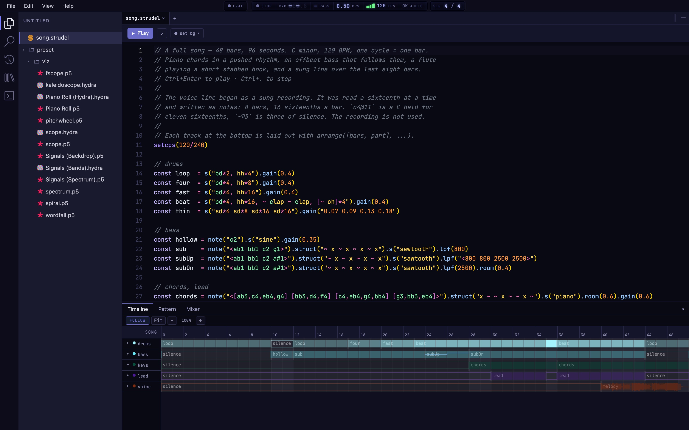

<div align="center">

# Stave

**A music studio for [Strudel](https://strudel.cc), in your browser. Write the song as code, then arrange it on a Timeline, edit it on a grid and mix it on a console. Every change in a view is written back into your code.**



[](LICENSE)
[](https://www.typescriptlang.org/)
[](https://react.dev/)
[](https://strudel.cc)

**[stave.live](https://stave.live)** · [Docs](https://stave.live/docs/) · [Contributing](CONTRIBUTING.md)

</div>

---

## What it is

Strudel is a wonderful way to make music: a few lines of code and a loop is playing. Turning those lines into a whole song is harder. You have to work out in your head where each part starts, how loud each track is, and which step a drum hit lands on.

Stave puts the views of a music studio next to your code:

- **Timeline:** the whole song, section by section.
- **Pattern:** the steps or notes of the line you're on.
- **Mixer:** a channel strip for every track.

You can work in any of them. Drag a section, paint a drum step or pull a fader, and Stave rewrites your code to match. Type in the code, and the views redraw. The code is still the song, so you can read it, copy it, share it, or keep writing it by hand.

Your projects are saved in your browser. There's no account and no server.

---

## Try it

Open **[stave.live](https://stave.live)**. The start screen offers a few templates:

| Template | What you get |
|---|---|
| **Full Song** | A finished 48-bar song: drums, bass, keys, a flute hook and a sung line written as notes. This is the quickest way to see the Timeline, Pattern and Mixer at work. |
| **Starter** | A Strudel pattern playing through the built-in p5.js and Hydra visualisers. |
| **Strudel Sketch** | A short pattern to start writing on. |
| **Hydra Visual** | An audio-reactive Hydra sketch. |
| **Blank** | An empty project. |

Or paste this into a new `.strudel` file and press Play:

```js
$: note("c3 e3 g3 b3").s("sine").gain(0.7).viz("spectrum")
$: s("bd*4, ~ cp").gain(0.9).viz("scope")
```

Each `$:` line is a track. It gets its own strip in the Mixer, its own row on the Timeline and its own visualiser, drawn right under the line.

---

## What you can do

### Arrange: the Timeline

- See the whole song, every track, with a playhead you can click to jump to any point.
- Work with sections:

  | To | Press |
  |---|---|
  | Duplicate a section | ⌘D |
  | Split a section in two | S |
  | Delete a section and leave a gap | Delete |
  | Delete a section and close the gap | ⌘⇧⌫ |
  | Insert an empty section | ⌘I |
  | Rename a section | F2 |
  | Point a section at a different part | P |

- Drag on the ruler to loop a stretch.
- Draw each track as **Bars** or as a **Waveform**, and give it a colour.
- Automate a parameter over the song in a lane under the track.

### Edit: the Pattern tab

The Pattern tab follows your cursor. It shows the line you're on as a grid:

- **Drum lines** open as a step sequencer. Click a step to turn it on or off, and drag up or down to set how hard it hits.
- **Chord lines** open as a chord chart.
- **Melodies** open as a piano roll. Place, move and resize notes, and hold one down to hear it.
- **Slots** sets how fine the grid is: halve it, double it, or pick 4, 8, 16, 32 or 64 steps.

Next to the grid is a column with the track's sound picker (you can hear each sound before choosing it), its effect knobs and an **Add effect** menu.

### Mix: the Mixer

- A channel strip for every track, with fader, pan, meter, mute and solo.
- Open a strip to see all its effect knobs.
- A Master strip for the whole mix.

The fader writes `.gain`, pan writes `.pan`, and mute and solo mute tracks in the code itself, so what you hear is what the code says.

### Sounds and visuals: the Library

- Search every sound Stave knows and hear it before you use it. Insert a sound into your code at the cursor.
- **Bring in your own audio:** drop a file onto the Library, choose one, or record a take from your microphone.
- Add ready-made visual sketches to your project and use them with `.viz("Name")`.

### Visualisers

- Add `.viz("…")` to a track and the visualiser draws between the code lines, fed by that track alone, not the whole mix. Built in: `pianoroll`, `wordfall`, `scope`, `fscope`, `spectrum`, `spiral` and `pitchwheel`, plus Hydra and GLSL ones.
- Write your own as `.p5`, `.hydra` or `.glsl` (ShaderToy-style) files. A new file starts with a short sketch that already reacts to the music, and it reloads as you type.
- Put a visual behind your code as a backdrop, or pop the preview out into its own window.

### Save and share

- **Bounce to WAV:** the whole mix, or one file per track (stems) in a zip.
- **Copy Share Link:** the whole project goes into the link itself, so nothing is uploaded. The link doesn't carry audio files; export a `.zip` for those.
- **Export and import** a project as a `.zip`, audio included.
- **Version History** lets you restore, fork or compare earlier versions of a project.

### On a phone or tablet

On a phone the code takes the whole screen:

- The sidebar and menus move into a drawer.
- Timeline, Pattern and Mixer open as a sheet over the code. Held sideways, you switch between them from the top bar.
- A row of pattern symbols (`~ * " [ ] < > ( )`) sits above the keyboard.
- A setting decides whether Play takes over the phone's audio or plays alongside your other apps.

### The editor

Stave is built on Monaco, the editor inside VS Code:

- Tabs, split panes and a command palette.
- Search across files, and search the docs.
- Autocomplete for every sound name, and hover docs.
- While a pattern plays, the notes that are sounding light up in the code.
- Errors show up in the code, not only in a console.
- Zen mode and keyboard shortcuts you can change.

### Not there yet

- **Sonic Pi:** you can create a `.sonicpi` file and get syntax highlighting, but its engine isn't bundled in this build, so it doesn't play yet.

---

## Run it locally

You need Node 20 or newer and pnpm 9 or newer.

```bash
git clone https://github.com/MrityunjayBhardwaj/stave-code.git
cd stave-code
pnpm install
pnpm dev          # the app on http://localhost:3000, the docs on http://localhost:4321/docs/
```

Tests:

```bash
pnpm --filter @stave/editor exec vitest run    # editor unit tests
pnpm --filter @stave/app test                  # app unit tests
pnpm gate:editing:browser:quick                # a short Playwright run
```

`pnpm gate:editing` runs the full set, including browser tests on desktop, phone and tablet sizes.

---

## How the code is laid out

```
stave-code/
├── packages/
│   ├── editor/     # @stave/editor: the studio's core (React + TypeScript, built with tsup)
│   │   └── src/
│   │       ├── engine/       # Strudel playback, offline render, WAV and stems, recording
│   │       ├── codeView/     # reads a song's structure from the code, and writes edits back
│   │       ├── visualEdit/   # the Pattern tab's grids and knobs, and the Mixer
│   │       ├── visualizers/  # inline .viz() visualisers: p5.js, Hydra, GLSL
│   │       ├── monaco/       # the Strudel language: highlighting, completions, hover docs
│   │       ├── workspace/    # files and folders (Yjs + IndexedDB), tabs, panels, history
│   │       └── theme/        # colours and the editor theme
│   ├── app/        # the Next.js app that runs stave.live: Timeline, Library, menus, phone layout
│   └── docs/       # the docs site (Astro Starlight), served at stave.live/docs
└── assets/         # screenshots
```

### Using the editor in your own app

`@stave/editor` isn't published to npm yet. Inside this workspace you can drop the editor into any React page:

```tsx
import { StrudelEditor } from '@stave/editor'

export default function App() {
  return (
    <StrudelEditor
      defaultCode={`$: note("c3 e3 g3 b3").s("sine").gain(0.7)`}
      height={400}
      onPlay={() => console.log('playing')}
      onStop={() => console.log('stopped')}
      onError={(err) => console.error(err)}
    />
  )
}
```

| Prop | Type | What it does |
|------|------|--------------|
| `code` | `string` | The code, controlled |
| `defaultCode` | `string` | The starting code, uncontrolled |
| `onChange` | `(code: string) => void` | Called when the code changes |
| `onPlay` / `onStop` | `() => void` | Called when playback starts and stops |
| `onError` | `(err: Error) => void` | Called on evaluation and runtime errors |
| `onExport` | `(blob: Blob, stemName?: string) => Promise<string>` | Handle an exported WAV yourself (for example, upload it) |
| `theme` | `'dark' \| 'light' \| StrudelTheme` | Editor theme |
| `engineRef` | `MutableRefObject<StrudelEngine>` | Direct access to the engine |

---

## Built with

- **Editor:** [Monaco](https://microsoft.github.io/monaco-editor/)
- **Audio:** [Strudel](https://strudel.cc) (`@strudel/core`, `@strudel/webaudio`, `@strudel/mini`, `@strudel/tonal`, `@strudel/soundfonts` and friends)
- **Visuals:** [p5.js](https://p5js.org), [Hydra](https://hydra.ojack.xyz), GLSL
- **Storage:** [Yjs](https://yjs.dev) + IndexedDB, local-first
- **App:** React 19, Next.js 16
- **Tooling:** TypeScript, pnpm workspaces, Turborepo, tsup, Vitest, Playwright

---

## Contributing

Contributions are welcome. [CONTRIBUTING.md](CONTRIBUTING.md) covers the DCO sign-off, the PR workflow and what not to commit.

This project follows the [Contributor Covenant Code of Conduct](CODE_OF_CONDUCT.md). To report a security problem, see [SECURITY.md](SECURITY.md).

## License

GNU Affero General Public License v3.0. See [LICENSE](LICENSE).
