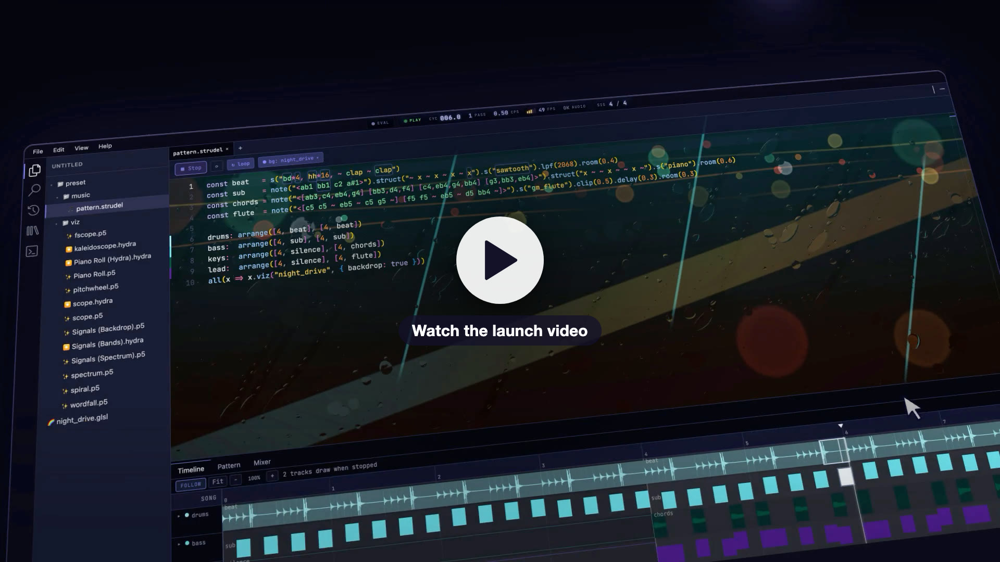
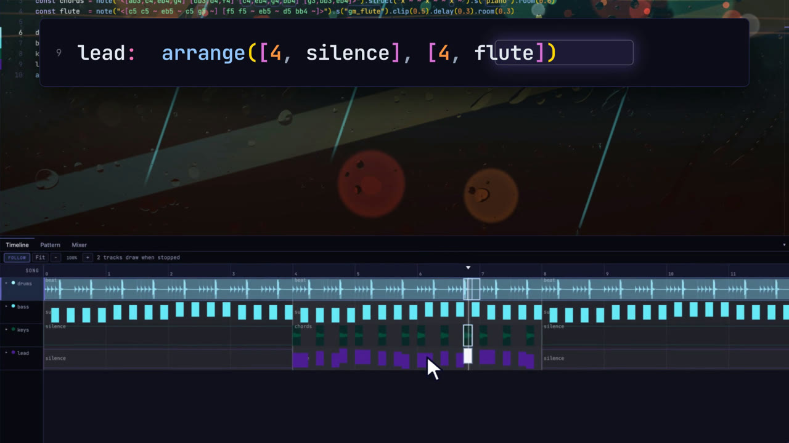
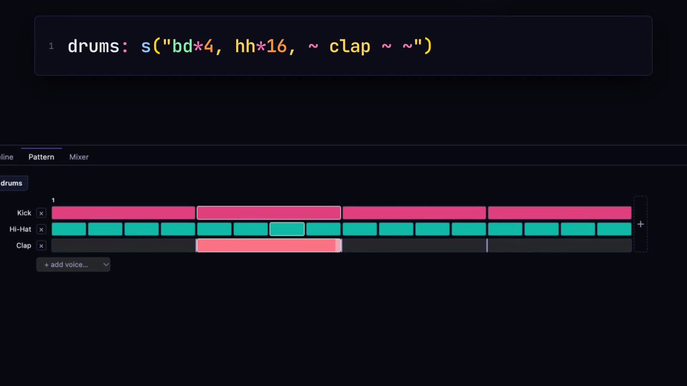
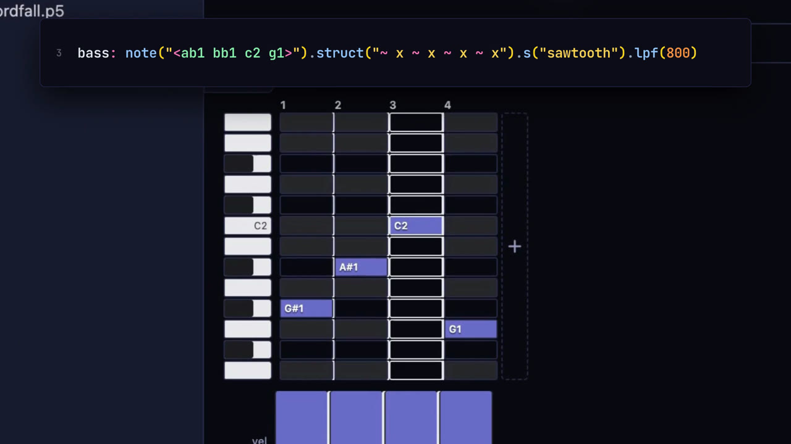
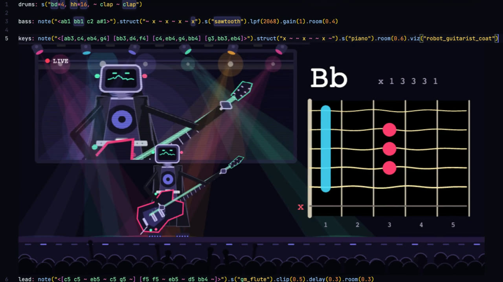
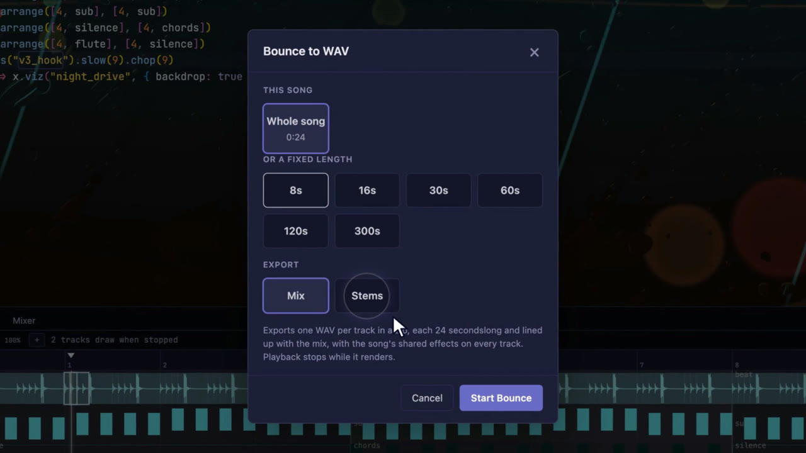

<div align="center">

# Stave

### Make a whole song in Strudel. Shape it like a DAW. Watch it come alive.

Write music as code. Arrange it on a Timeline, paint beats on a grid, mix it on a console,<br/>
and make visuals that move with every kick. Every change you make in a view is written back into your code.

**[Open Stave →](https://stave.live)** &nbsp;·&nbsp; [Docs](https://stave.live/docs/)

[](https://github.com/MrityunjayBhardwaj/Stave/actions/workflows/ci.yml)
[](https://github.com/MrityunjayBhardwaj/Stave/releases)
[](LICENSE)
[](https://github.com/MrityunjayBhardwaj/Stave/discussions)
[](https://github.com/MrityunjayBhardwaj/Stave/labels/good%20first%20issue)

<br/>

<a href="https://www.youtube.com/watch?v=LoVfu-FCTAg"></a>

<sub>Free and open source · Runs in your browser · Nothing to install · No account</sub>

</div>

---

## Why Stave

[Strudel](https://strudel.cc) is a joyful way to make music: type one line and a beat starts playing. Stave is for when that line grows into a whole song, and you'd like to see it as well as hear it.

- **See the whole song.** A Timeline lays out every track and section, shows where the chorus starts and how long the verse runs, and follows the playhead as it plays.
- **See what each line plays.** `"bd [~ bd] ~ bd"` appears as a drum grid you can click, and a melody as a piano roll you can drag. It's a friendly way in if you're new to code, and familiar ground if you come from a DAW.
- **Visuals that follow the notes.** Your sketches receive every kick, snare and note straight from the pattern, so the music and the visuals stay in step, in one place.

## How it fits together

**Stave is a studio built around your Strudel code.** It keeps your code and gives it the views a music producer expects: a Timeline, a step grid and piano roll, a Mixer, and visuals that know exactly what the music is doing.

**It works both ways.** Pull a fader and the `.gain` in your code changes. Click a step on the grid and the beat in your code changes. Type a new note and the grid redraws. Your code is always the song, so you can still read it, share it, and learn from it. The views let you see it too.

---

## How it works

### 1. Code it

Write Strudel in Monaco, the editor inside VS Code, with autocomplete for every sound, hover docs, and errors shown right in the code. While the song plays, the notes that are sounding light up. Each `$:` line, or each name you give a part (`drums:`, `bass:`), is a track.

### 2. Arrange it



The **Timeline** shows your whole song, track by track and section by section.

- Duplicate a chorus, split a verse, insert a gap, rename a section, or drag a stretch to loop it.
- Draw a parameter's automation across the song, like a filter opening up over eight bars.
- Each section is an `arrange(...)` entry in your code, and editing one rewrites it there.

### 3. Shape it

<p>
  
  
</p>

The **Pattern** tab follows your cursor and shows that line as a grid:

- **Drum lines** become a step sequencer. Click a step to turn it on or off, and drag up or down to set how hard it hits.
- **Melodies** become a piano roll. Place, move and stretch notes, and hold one down to hear it.
- **Chord lines** become a chord chart.

Every click rewrites the mini-notation in your code. Watching it change is the fastest way to learn what `"bd*4, hh*16"` means.

### 4. Mix it


The **Mixer** gives every track a channel strip: fader, pan, meter, mute and solo, plus a chain of effects (reverb, delay, filters and more) and a Master strip. The fader writes `.gain`, an effect writes `.lpf(800)`, and mute and solo mute tracks in the code itself, so what you hear is always what the code says.

### 5. See it



Stave knows every note your code plays, and it hands each one to your sketch:

- `sig.kick`, `sig.snare`, `sig.hat`, `sig.clap`… jump to 1 the moment that drum plays, then fade.
- `sig('bd')` follows one sound, and `sig.track('$0')` follows one track.
- `sig.fft`, `sig.wave`, `sig.bass` and `sig.treble` are there too, when you want the sound itself.

Here's a whole audio-reactive sketch. Make a file called `kick.p5`, paste this and save:

```js
function setup() {
  createCanvas(stave.width, stave.height)
}

function draw() {
  background(10, 10, 20, 60)
  noStroke()
  fill(120, 220, 255)
  circle(width / 2, height / 2, 20 + sig.kick * 120)
}
```

Then point a track at it with `$: s("bd*4, ~ cp").viz("kick")`. The circle jumps on every kick, drawn right under that line of code. Change the beat and the visual follows, because both come from the same pattern.

- **Write sketches in p5.js, Hydra or GLSL** (ShaderToy-style). A new visual file starts with a sketch that already reacts, and it reloads when you save.
- **Put any visual behind your code** as a backdrop, or pop it out into its own window for a projector or a second screen.
- **Start from ready-made ones.** There are built-in visualisers (`pianoroll`, `scope`, `spectrum`, `spiral` and more), and sketches in the Library you can add with one click.

### 6. Share it



- **Bounce** the whole song to WAV, as one mix or as one file per track (stems).
- **Copy a share link.** The whole project goes into the link itself, so nothing is uploaded.
- **Export a `.zip`** with your audio included, or roll back with version history.

---

## Start in 30 seconds

1. Open **[stave.live](https://stave.live)**.
2. Pick **Full Song**. It's a finished 48-bar track with drums, bass, keys, a flute hook and a sung melody.
3. Press **Play**, then open the **Timeline**, **Pattern** and **Mixer** tabs at the bottom and start poking around.

Or start from nothing. Make a new `.strudel` file, paste this, and press <kbd>Ctrl</kbd>+<kbd>Enter</kbd>:

```js
$: note("c3 e3 g3 b3").s("sine").gain(0.7).viz("spectrum")
$: s("bd*4, ~ cp").gain(0.9).viz("scope")
```

Each `$:` line is a track. It gets its own row on the Timeline, its own strip in the Mixer, and a visualiser drawn right under the line.

---

## Who it's for

**🌱 You're new to Strudel, or new to code.** Start from a song that already works. Click a step on the drum grid and watch the code change. You learn the language by seeing what each part does.

**🎛️ You make music in a DAW.** Arrange, sequence and mix are all where you'd look for them. Underneath is a pattern language that makes variations and generative ideas a one-line change.

**⌨️ You live-code already.** Keep writing everything by hand. Stave just shows you what's playing, where you are in the song, and how loud each part is, and it stays out of the way.

**🌈 You make visuals.** Your sketch gets every kick, snare and note as it plays. Write in p5.js, Hydra or GLSL, and send it to a projector in its own window.

---

## And also

- 🔊 **A sound library.** Search every sound and hear it before you use it. Drop in your own audio, or record a take from your mic.
- 📱 **Phones and tablets.** Stave has its own layout for small screens, with a row of pattern symbols above the keyboard.
- 🧭 **Templates.** Start from a full song, a short sketch, a Hydra visual or a blank page.

## What's next

Stave is at **0.5**, its first beta. What it does today is in the [changelog](CHANGELOG.md), and the full [roadmap](https://stave.live/docs/roadmap/) has what's coming; in short:

- **0.6: nested patterns and 3D visuals.** The Pattern grids draw a pattern's own divisions, and zoom opens each level of nesting. three.js joins p5.js, Hydra and GLSL for visuals. Plus a round of bug fixes across the Timeline, the grids and the Mixer.
- **0.7: Sonic Pi and MIDI out.** Stave's Sonic Pi support comes from our sister project [Sonic Web](https://github.com/MrityunjayBhardwaj/SonicWeb): Sonic Pi in the browser, built on [SuperSonic](https://github.com/samaaron/supersonic), with the same `play`, `sleep` and `live_loop`. You can already play with it on its own at [sonicweb.cc](https://sonicweb.cc). Inside Stave today, `.sonicpi` files open with highlighting but don't play yet. MIDI output, which today only works from code, gets a device list, a send switch per track and mixer knobs that send CC.

---

## Free, and yours

- **No sign-up.** Open the page and make music.
- **No ads, no paywall.** Everything above is free.
- **Your projects stay in your browser.** No server holds your songs. A share link carries the project inside the link itself.
- **The music you make is yours.** The licence covers Stave's code, not your songs.
- **Open source** under AGPL-3.0, like Strudel.
- **The only measurement:** anonymous page-view counts through Vercel Web Analytics. It sets no cookies and reads nothing from the editor.

---

## Make Stave better with us

You don't need to write code to help:

- 🐛 **Tell us what broke or confused you.** [Open an issue](https://github.com/MrityunjayBhardwaj/Stave/issues/new). A screenshot and the code you were playing help a lot.
- 💡 **Tell us what you wish it did.** Feature ideas from people making real songs shape what gets built next.
- 🎶 **Share what you make.** A song made in Stave is the best bug report and the best demo.

If you do write code, issues marked [**good first issue**](https://github.com/MrityunjayBhardwaj/Stave/labels/good%20first%20issue) and [**help wanted**](https://github.com/MrityunjayBhardwaj/Stave/labels/help%20wanted) are a good place to start. [CONTRIBUTING.md](CONTRIBUTING.md) covers the rest. Everyone here follows the [Code of Conduct](CODE_OF_CONDUCT.md).

<details>
<summary><b>Run Stave on your own machine</b></summary>

<br/>

You need Node 22.12+ and pnpm 9+.

```bash
git clone https://github.com/MrityunjayBhardwaj/Stave.git
cd Stave
pnpm install
pnpm dev          # the app on http://localhost:3000, the docs on http://localhost:4321/docs/
```

Tests:

```bash
pnpm --filter @stave/editor exec vitest run    # editor unit tests
pnpm --filter @stave/app test                  # app unit tests
pnpm gate:editing:browser:quick                # a short Playwright run
```

`pnpm gate:editing` runs everything, including browser tests at desktop, phone and tablet sizes.

</details>

<details>
<summary><b>How the code is laid out</b></summary>

<br/>

```
Stave/
├── packages/
│   ├── editor/     # @stave/editor: the studio's core (React + TypeScript, built with tsup)
│   │   └── src/
│   │       ├── engine/       # Strudel playback, offline render, WAV and stems, recording
│   │       ├── codeView/     # reads a song's structure from the code, and writes edits back
│   │       ├── visualEdit/   # the Pattern tab's grids and knobs, and the Mixer
│   │       ├── visualizers/  # inline .viz() visualisers: p5.js, Hydra, GLSL
│   │       ├── monaco/       # the Strudel language: highlighting, completions, hover docs
│   │       ├── workspace/    # files and folders (Yjs + IndexedDB), tabs, panels, history
│   │       └── theme/        # colours and the editor theme
│   ├── app/        # the Next.js app that runs stave.live: Timeline, Library, menus, phone layout
│   └── docs/       # the docs site (Astro Starlight), served at stave.live/docs
└── assets/         # screenshots
```

Built with Monaco, Strudel, p5.js, Hydra, Yjs, React 19 and Next.js 16, plus TypeScript, pnpm, Turborepo, Vitest and Playwright.

</details>

<details>
<summary><b>Use the editor in your own React app</b></summary>

<br/>

`@stave/editor` isn't published to npm yet. Inside this workspace:

```tsx
import { StrudelEditor } from '@stave/editor'

export default function App() {
  return (
    <StrudelEditor
      defaultCode={`$: note("c3 e3 g3 b3").s("sine").gain(0.7)`}
      height={400}
      onPlay={() => console.log('playing')}
      onStop={() => console.log('stopped')}
      onError={(err) => console.error(err)}
    />
  )
}
```

| Prop | Type | What it does |
|------|------|--------------|
| `code` / `defaultCode` | `string` | Controlled or starting code |
| `onChange` | `(code: string) => void` | Called when the code changes |
| `onPlay` / `onStop` | `() => void` | Called when playback starts and stops |
| `onError` | `(err: Error) => void` | Called on evaluation and runtime errors |
| `onExport` | `(blob: Blob, stemName?: string) => Promise<string>` | Handle an exported WAV yourself |
| `theme` | `'dark' \| 'light' \| StrudelTheme` | Editor theme |
| `engineRef` | `MutableRefObject<StrudelEngine>` | Direct access to the engine |

</details>

---

## Thank you

Stave stands on the shoulders of some wonderful projects:

- [Strudel](https://strudel.cc) and the TidalCycles community, who made patterns this much fun.
- [Hydra](https://hydra.ojack.xyz), [p5.js](https://p5js.org) and GLSL shaders in the style of [ShaderToy](https://www.shadertoy.com), for the visuals.
- [Sonic Pi](https://sonic-pi.net) and [SuperSonic](https://github.com/samaaron/supersonic), for live-coded music and the synth engine that runs it in the browser.
- [Monaco](https://microsoft.github.io/monaco-editor/), the editor at the heart of VS Code.

## License

[GNU AGPL v3.0](LICENSE). To report a security problem, see [SECURITY.md](SECURITY.md).
