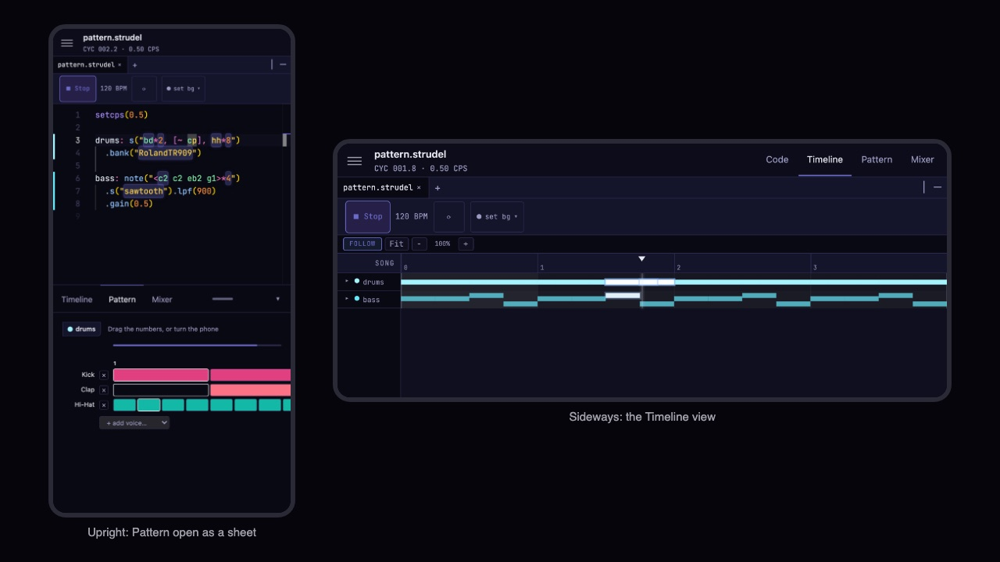

import { Aside } from '@astrojs/starlight/components';

Stave has its own layout for small screens. On a phone the code takes the whole screen, and everything else is a tap away.

## The top bar

- **☰** opens the drawer, with your project's panels (Files, Search, History, Library, Console) and a **Menu** tab holding every menu from the desktop. Tap outside the drawer to close it.
- The middle shows the file you're in, the song position and the tempo.
- **Play** lives in the editor's own bar, sized for a finger.

## Held upright

The **Timeline**, **Pattern** and **Mixer** tabs sit at the bottom. Drag the tab strip up to open them as a sheet over the code, at half height or full screen, and drag it down to close it.

When the keyboard is up in a code file, a row of the symbols patterns use most sits right above it: `~ * " [ ] < > ( )`. Each tap is one undo step.

## Held sideways

The top bar gets a switch: **Code · Timeline · Pattern · Mixer**. The view you pick fills the screen.

## On a touch screen

- Only the code can be selected. Pressing and holding on a panel doesn't select its text.
- Tapping the Timeline or Mixer doesn't bring up the keyboard.
- In the Pattern tab the grid takes the whole width, and its steps are wide enough to tap. When a track has more steps than fit, Stave says "Drag the numbers, or turn the phone": drag the row of step numbers to move along, or hold the phone sideways to see more.

## Sound on a phone

**Settings › Sound › Play through the silent switch** decides how Stave shares your phone's audio:

- **On** (the default): you hear Stave even with the ring/silent switch on, and music from other apps stops when you press Play.
- **Off**: other apps keep playing alongside Stave, and the silent switch mutes it.

<Aside type="tip">
A phone's browser only starts sound when you tap something, so Stave starts the audio inside your tap on **Play**. If you hear nothing with the setting off, check the silent switch.
</Aside>
