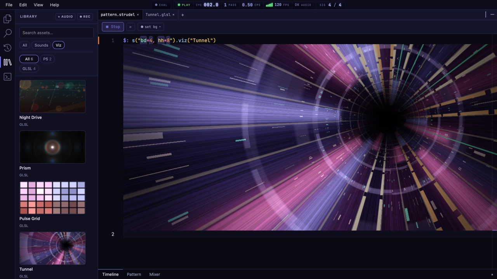

import { Aside } from '@astrojs/starlight/components';

The **Library** is in the activity bar on the left. It holds every sound Stave knows, your own audio, and visual sketches you can add to your project.

## Finding things

- **Search assets…** searches everything.
- The type filter shows **All**, **Sounds** or **Viz**.
- Once you've added audio of your own, a source filter appears: **All**, **Built-in** or **User**.
- The category chips narrow it further, with a count on each.

Sounds are grouped as **Drums** (one group per drum machine), **Synths**, **Soundfonts**, **Wavetables**, **Samples** and **Your audio**.

## Using a sound

Hover over a row:

- **▶** plays it. Press again to stop.
- **+** inserts it into your code. If your cursor is on a melody, it sets that melody's sound with `.sound('name')`. Otherwise it adds a new line, `s("name")`.
- **Copy** copies its name, ready to paste.

## Your own audio

- **+ AUDIO** adds audio files from your computer, several at once. You can also drop files onto the Library.
- **REC** records a take from your microphone. **STOP** ends it. Takes are named `take_1`, `take_2` and so on.

Stave cleans up the names, so `My Take (2).wav` becomes `my_take_2`, and you use it like any other sound:

```js
$: s("my_take_2")
```

When you insert one of your own clips, Stave adds a `slow` so the whole clip plays through before it starts again. The trash button removes a clip from the project.

<Aside type="note">
Your audio is stored in your browser, next to the project. **Export as .zip** includes it; a share link doesn't. If the browser runs out of space, Stave tells you and doesn't save the take, and you can download it to keep it.
</Aside>

## Visuals

The **Viz** filter lists finished sketches, like the ones from the launch video. Hover over one and press **+** (**Add to workspace**) to copy it into your project under `viz_lib/<Name>/`. Stave opens its file in a tab, and you can use it right away:

```js
$: s("bd*4, hh*8").viz("Tunnel")
```



Its file is yours to read or change. See [Make visuals react](/guides/reactive-visuals/) to write your own.
