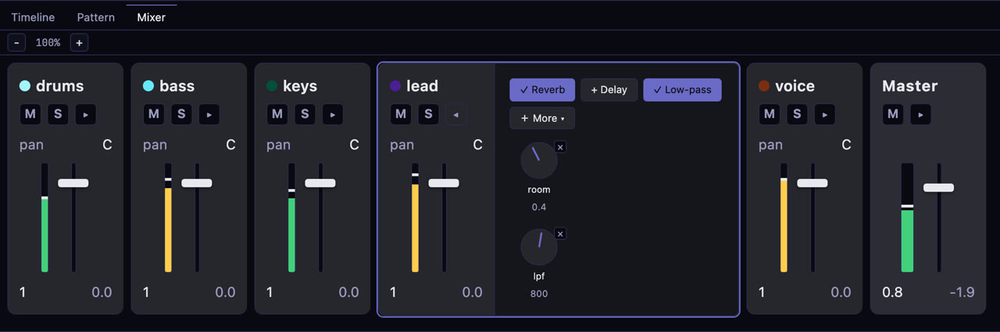

import { Aside } from '@astrojs/starlight/components';

The **Mixer** tab gives every track a channel strip, plus a **Master** strip for the whole mix. Whatever you do here is written into your code, so what you hear is always what the code says.

## A channel strip

| Control | What it does | What it writes |
|---|---|---|
| **Fader** | Drag up or down to set the level. Double-click to reset it to 1. | `.gain(0.8)` |
| **pan** | Drag sideways. Reads **C**, **L20**, **R35** and so on. | `.pan(0.3)` |
| **M** | Mute or unmute the track. | `_` in front of the track, as in `_drums:` |
| **S** | Solo: hear this track alone. | `_` on every other track. Un-solo brings back the mutes you set yourself. |
| **▸** | Open the strip's effects. | |
| **Colour dot** | Pick the track's colour. | Saved with the project |
| **Name** | Double-click to rename the track. | a `name:` label |

The meter beside the fader shows the track's level as it plays, and the readout under it shows the gain and its dB.

<Aside type="note">
Only a track with a name or a `$:` can be muted, because the mute is written as `_` in front of it. If the gain is a pattern or a signal rather than a number, the readout shows **sig**: edit that one in the code.
</Aside>

## Effects

Press **▸** on a strip to open its effects, the same ones as in the [Pattern](/studio/pattern/#sound-and-effects) tab's side column:

- **+ Reverb**, **+ Delay** and **+ Low-pass** add that effect with a knob. Each one writes a method into your code, like `.room(0.4)` or `.lpf(800)`.
- **＋ More ▾** has the rest, with a search box: filters, distortion, bitcrush, envelope, speed, pitch shift and more.
- **Drag a knob** to change it. **×** removes it and its method. **Double-click** a knob to set its range.

## Master

The **Master** strip controls the whole mix:

- **The fader** writes one line that scales every track: `all(x => x.mul(postgain(0.8)))`.
- **M** silences everything, with the line `all(x => silence)`. Unmuting removes it.
- **▸** opens effects for the whole mix.

There's no master pan, on purpose. Pan each track instead.

## Zoom

**−** and **+** at the top make the strips smaller or bigger (50% to 200%). When the strips don't fit, the Mixer scrolls sideways.
