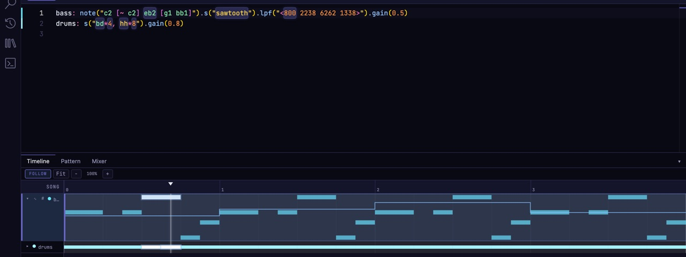

import { Aside } from '@astrojs/starlight/components';


The **Timeline** tab shows your whole song: one row per track, each row split into sections, with a playhead that moves as the song plays. It's drawn from your code, and editing it rewrites your code.

## Moving around

- **Click the ruler** to move the playhead there.
- **Click a track's row** to jump the editor to that track's code.
- **FOLLOW** keeps the playhead in view while the song plays.
- **Fit** zooms out to the whole song. **−** and **+** zoom out and in, and **⌘ + mouse wheel** zooms around the pointer. A plain wheel scrolls sideways.
- **Drag the edge below a track** to make the rows taller or shorter.

## How long the song is

A song with an `arrange(...)` is as long as its arrangement. Anything else, Stave works out by listening for the song to come back round, and shows one pass of it.

A song that hasn't come back round within 64 cycles shows **64+ cycles**, with "no repeat · showing first 64 cycles" above the tracks, and moves on to the next 64 as it plays. A control moved by `rand`, `perlin` or `time` never comes back, so a song with one always does this. An arrangement longer than 64 cycles is shown 64 at a time too.

To look further, raise **Settings › Pattern & Timeline › Longest timeline**, up to 256 cycles. A loop is found once it has played twice within that limit, so a 40-cycle loop needs a limit of 80 or more.

## Looping a stretch

The thin strip along the top of the ruler is the loop.

- **Drag** across an empty stretch to loop it.
- **Drag an edge** to resize the loop, or **drag its middle** to move it.
- **Click** the strip to switch the loop off and on. While it's off, the loop stays in place, faded, ready to switch back on.

## Tracks

Each track's header has:

- **▸ / ▾** to expand the row and see its notes. Double-clicking a row does the same.
- **The colour dot** to pick a colour. **Reset to default colour** goes back.
- **The name.** Click it to jump to the track's code. Double-click or right-click it for the track menu:
  - **Type ▸ Waveform** draws the track's audio: a sample's file, or a render of a synth.
  - **Type ▸ Bars** draws only the notes.
  - **Rename** gives the track a name in your code.

<Aside type="note">
A synth's waveform can only be drawn while the song is stopped, so the Timeline may say "2 tracks draw when stopped". The colour and the Bars/Waveform choice are saved with the project, not in your code.
</Aside>

## Sections

A section is one entry in a track's `arrange(...)`, like `[4, chorus]`: four bars of the part called `chorus`. Click a section to select it.

- **Drag** a section to move it among the other sections.
- **Drag its right edge** to make it longer or shorter, in bars.

With a section selected:

| To | Press |
|---|---|
| Duplicate the section | ⌘D |
| Split it in two (sections of 2 bars or more) | S |
| Delete it and leave a gap | Delete |
| Delete it and close the gap, so the song gets shorter | ⌘⇧⌫ |
| Insert an empty section after it | ⌘I |
| Rename it | F2 or Enter |
| Point it at a different part | P |

Renaming a part that plays in more than one place warns you first ("renames 3 sections"), since they all share that name. To change just one, use **P** to point it at a different part.

You can change these keys in **Settings › Keyboard Shortcuts**, under "Song timeline".

## Automation

Expand a track, then press **∿** in its header to **automate a parameter**. Stave offers every fixed number on the track that can be automated, such as `lpf 800` or `gain 0.4`. Pick one and Stave writes one value per bar:

```js
.lpf(800)                       // before
.lpf("<800 800 800 800>")       // after: one step per bar
```



The steps are drawn as a line across the expanded track, over its notes. Shape them there:

- **Drag a step** up or down. Hold **Shift** for finer control.
- **Click a step** to type a value.
- **#** changes how many steps there are. Each choice tells you what it will do, such as "3 steps · song repeats every 12 bars (was 4)".

A parameter that already follows a curve, like `sine.range(200, 2000)`, shows its curve instead. Click the numbers on its caption to change the low and high values and how many bars it takes, or click its name to pick a different shape (`sine`, `tri`, `saw`, `square`, `perlin`, `rand` and more).

## Bars, beats and time signature

The **Sig** control in the top bar sets how bars and beats are counted and drawn, for example 3/4 or 6/8. It never changes what plays: a bar is always one cycle of your pattern.

The transport display next to it shows **PLAY**/**STOP** (or **LOAD** while a Play is still loading its sounds; pressing Stop then cancels it), the position, which time through the song this is (**PASS**), the tempo, the frame rate, and whether the audio is keeping up (**OK**, **LATE** or **GLITCH**). Click it to switch between cycles and bars.
